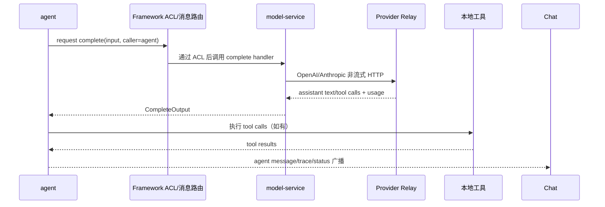
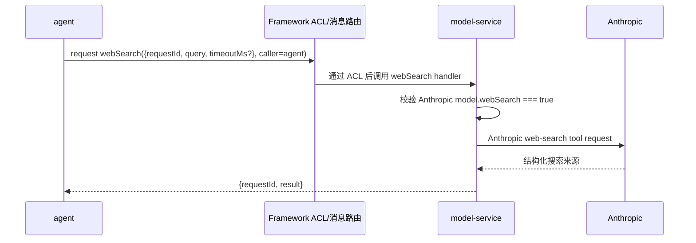
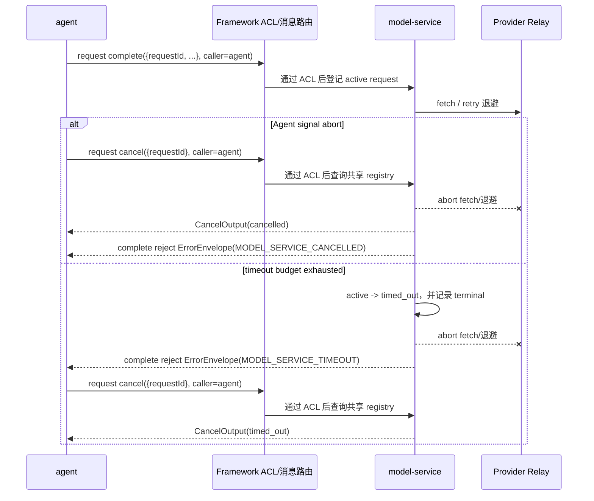
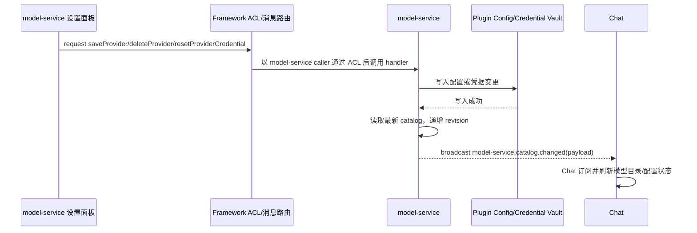

# Harbors Harness Kit 的 model-service Plugin

`model-service` 是 Harbors Harness Kit 内负责模型访问和 Provider 配置的后台 Plugin。它把配置、凭据解析、
Provider 协议适配、HTTP transport 和请求终态管理从 `agent` 的会话与工具循环中隔离出来。本文描述
当前实现的消息契约和边界。Agent 的 Item 生命周期与持久化事件协议见
`agent-turn-event-protocol.md`；本文只定义 Model Service 的请求、流式增量和取消边界。

## 职责边界

### model-service 负责

- 从绑定的 Plugin Config 读取 Provider、模型目录、默认模型和重试/超时选项。
- 通过 Credential Vault 读取 Provider 凭据。凭据只在 Plugin 内存中用于请求，不进入消息返回值、日志、
  会话事件或模型目录。
- 根据 Provider 配置选择 `openai-completions` 或 `anthropic-messages`，构造 URL、认证 Header 和
  Provider payload。
- 执行单次非流式 HTTP 请求、超时、重试、`Retry-After` 退避、响应归一化和取消。
- 持久化 Provider 配置，并在成功写入后广播模型目录变化。

### agent 负责

- 会话生命周期、事件日志、上下文 surface、压缩决策、工具定义、工具执行、权限、trace 和 UI 状态广播。
- 将事件 surface 转换为中立的模型消息，并把模型返回的 tool calls 解析后执行。
- 在下一轮 request 中带回 assistant tool calls 和 tool results；`model-service` 不执行本地工具。

两者之间只通过消息 request 交互。Plugin 不直接 import 另一 Plugin 的实现，也不使用
`plugin.callPlugin` 作为业务通道。

### User 范围的配置与凭据

Host 从 Session owner 绑定 User。Model Service 的 Config 与 Credential Vault 默认范围均为
User + Kit + Plugin；同 User 的基础 Session 可读取相同 Provider 设置和凭据，不同 User
不会因 Provider ID 相同而共用。`global` 层指该 User 跨 Session，真实 secret 仍留在 Keychain。
Host 使用 `bind(userId, kitId, pluginName)` 绑定 Vault，业务消息不能指定其他 User 或 scope。

新的 User 配置根与凭据 scope 不回退旧无 User 存储，也不迁移或删除旧配置/secret。升级后
可能需要在当前 User 下重新配置 Provider；缺少凭据保持既有配置提示与错误语义。配置路径
详见 [Kit 配置模型](./kit-configuration-model.md)。

## 消息入口与 ACL

`model-service/package.json` 声明的 request 入口如下：

```json
{
  "getCatalog": ["getCatalog"],
  "getSettings": { "methods": ["getSettings"], "callers": ["model-service"] },
  "saveProvider": { "methods": ["saveProvider"], "callers": ["model-service"] },
  "deleteProvider": { "methods": ["deleteProvider"], "callers": ["model-service"] },
  "resetProviderCredential": { "methods": ["resetProviderCredential"], "callers": ["model-service"] },
  "webSearch": { "methods": ["webSearch"], "callers": ["agent"] },
  "complete": { "methods": ["complete"], "callers": ["agent"] },
  "cancel": { "methods": ["cancel"], "callers": ["agent"] }
}
```

`complete`、`cancel` 和 `webSearch` 只允许 `agent` caller。Framework 在进入 model-service 的 handler
之前，根据受信 caller 执行 manifest 中的 ACL；未授权请求在 Framework 路由层被拒绝，不会进入
Model Service，也不会被包装成下文的 `ErrorEnvelope`。设置面板使用 `model-service` caller 访问
`getSettings`、`saveProvider`、`deleteProvider` 和 `resetProviderCredential`。`getCatalog` 是无
`callers` 限制的目录读取 request。

普通 request 的 caller 由 Host 绑定。同步 `plugin.callPlugin` 同样检查 manifest 的 server
request 声明和 callers，不能换入口调用 Model Service 的受限或未公开方法。

## 请求与错误协议

所有带请求生命周期的操作使用调用方生成的不透明 `requestId`。request 的成功值沿消息边界返回；
Model Service handler 产生的业务错误通过 request reject 传递，并使用稳定的错误 envelope：

```ts
interface ErrorEnvelope {
  code: ModelServiceErrorCode;
  message: string;
  retryable: boolean;
  requestId: string;
}

type ModelServiceErrorCode =
  | 'UNAUTHORIZED'
  | 'INVALID_INPUT'
  | 'UNSUPPORTED_CAPABILITY'
  | 'MODEL_SERVICE_NOT_CONFIGURED'
  | 'MODEL_SERVICE_UNSUPPORTED_API'
  | 'MODEL_SERVICE_HTTP_ERROR'
  | 'MODEL_SERVICE_CONTEXT_OVERFLOW'
  | 'MODEL_SERVICE_INVALID_RESPONSE'
  | 'MODEL_SERVICE_NETWORK_ERROR'
  | 'MODEL_SERVICE_TIMEOUT'
  | 'MODEL_SERVICE_CANCELLED'
  | 'MODEL_SERVICE_STOPPED';
```

`message` 必须是安全的可展示信息，不携带凭据、凭据来源、凭据文件路径、环境变量名或原始 Provider
response。Framework ACL 的未授权拒绝发生在 handler 之前，不属于这个 envelope；进入 handler 后的
参数校验、能力拒绝、Provider/网络失败、取消和超时才按上述结构 reject。虽然类型联合保留
`UNAUTHORIZED`，当前跨 Plugin ACL 拒绝不会由 Model Service handler 产生该 envelope。

## getCatalog

输入为空，返回当前配置和 Provider 能力与适配器能力的交集：

```ts
interface ModelCatalogEntry {
  id: string;
  name: string;
  description?: string;
  contextWindow?: number;
  reasoningEfforts?: string[];
  serviceTiers?: string[];
  defaultReasoningEffort?: string;
  defaultServiceTier?: string;
  webSearch?: boolean;
}

interface ModelCatalog {
  models: ModelCatalogEntry[];
  defaultModel: string;
  configurationError?: {
    code: 'MISSING_BASE_URL' | 'MISSING_CREDENTIAL';
    message: string;
  };
}
```

OpenAI-compatible Provider 的 `reasoningEfforts`、`serviceTiers` 及其有效默认值可出现在目录中；
Anthropic Provider 不宣称这两类能力，即使配置中存在对应字段。`webSearch` 只有在 Anthropic model
显式配置 `webSearch: true` 时才出现在有效目录能力中。配置缺失仍返回 catalog，便于 Agent/Chat
显示稳定的配置提示；提示文本不包含凭据或内部标识。

## complete

输入和输出使用 Provider-neutral 结构：

```ts
interface TextContentBlock { type: 'text'; text: string; }
interface ImageContentBlock { type: 'image'; mediaType: string; data: string; }
type ContentBlock = TextContentBlock | ImageContentBlock | Record<string, unknown>;

interface NeutralToolCall {
  id: string;
  name: string;
  arguments: string;
}

interface NeutralMessage {
  role: 'user' | 'assistant' | 'tool';
  content: string | ContentBlock[] | null;
  toolCalls?: NeutralToolCall[];
  toolCallId?: string;
  isError?: boolean;
}

interface ModelTool {
  name: string;
  description: string;
  inputSchema: Record<string, unknown>;
}

interface CompleteInput {
  requestId: string;
  purpose: 'turn' | 'compaction';
  model?: string;
  system?: string;
  messages: NeutralMessage[];
  tools?: ModelTool[];
  maxOutputTokens?: number;
  retryMode?: 'default' | 'disabled';
  reasoningEffort?: string;
  serviceTier?: string;
  /** milliseconds; a caller can only shorten the configured provider timeout */
  timeoutMs?: number;
}

interface CompleteOutput {
  requestId: string;
  model: string;
  message: {
    role: 'assistant';
    content: string | ContentBlock[] | null;
    toolCalls?: NeutralToolCall[];
  };
  usage?: {
    inputTokens: number;
    outputTokens: number;
    totalTokens: number;
    cacheReadTokens?: number;
    cacheWriteTokens?: number;
    reasoningTokens?: number;
  };
}
```

`purpose: "turn"` 使用正常重试，普通主模型请求的输出上限为 16,384；`purpose: "compaction"` 使用
`retryMode: "disabled"`，由 Agent 决定何时压缩上下文，压缩请求的上限沿用调用方传入值。

`reasoningEffort` 和 `serviceTier` 只有在当前模型目录宣称支持时才接受。OpenAI-compatible 请求把
它们分别映射为 Provider payload 的 `reasoning_effort` 和 `service_tier`，未显式传入时可使用模型的
有效默认值；Anthropic 请求不宣称或发送这两项能力。`arguments` 保留 tool call 的 JSON 文本，
Agent 负责解析和执行。`usage` 只有数量统计，不是访问凭据。

`timeoutMs` 是本次请求的毫秒预算。它只能缩短已配置的 Provider timeout 和系统 timeout，不能延长
任一上限；实际预算取 Provider、系统/注入预算和请求值的最小值。超时后 request reject 为
`MODEL_SERVICE_TIMEOUT`，且该 request 进入 `timed_out` 终态。

## webSearch

`webSearch` 不接受旧的字符串或只含 query 的 legacy 形态，只接受结构化输入，并返回结构化结果：

```ts
interface WebSearchInput {
  requestId: string;
  query: string;
  timeoutMs?: number;
}

interface WebSearchOutput {
  requestId: string;
  result: string;
}
```

只有当前解析到的 Anthropic model 显式设置 `webSearch: true` 时才允许调用；OpenAI-compatible 和未
声明该能力的 Anthropic model 均 reject `UNSUPPORTED_CAPABILITY`。Model Service 在内部调用 Anthropic
web-search tool，并将结构化来源归一化为 `result` 字符串；Provider 凭据和原始 response 不跨消息边界
返回。`timeoutMs` 遵循与 `complete` 相同的“只能缩短 Provider/系统预算”规则。

## cancel 与请求终态

```ts
interface CancelInput { requestId: string; }
type CancelState =
  | 'cancelled'
  | 'already_cancelled'
  | 'completed'
  | 'timed_out'
  | 'failed'
  | 'not_found';
interface CancelOutput { requestId: string; state: CancelState; }
```

`complete` 和 `webSearch` 共用同一组 active/terminal request registry，`cancel` 也查询并更新这组
registry，因此两种操作的 requestId 不能复用。状态含义如下：

- `cancelled`：请求仍 active 时成功发起取消；对应 request reject 为 `MODEL_SERVICE_CANCELLED`。
- `already_cancelled`：请求已经以取消终态结束，再次取消。
- `completed`：请求已成功完成。
- `timed_out`：请求已因预算耗尽终止。
- `failed`：请求已因 Provider、网络、停止/卸载或其他失败终止。
- `not_found`：registry 中没有该 requestId。

取消会中止 HTTP fetch 或 retry 退避，取消后的 `complete`/`webSearch` 不再重试。Plugin unload 会中止
所有活动请求，并使对应 request reject 为 `MODEL_SERVICE_STOPPED`；其已记录终态通过 `cancel` 表示
为 `failed`。

## 消息顺序

### 正常 turn



下一轮 turn 由 Agent 再次发送新的 `complete` request，并带回 assistant tool calls 和 tool results。

### webSearch



### 取消与超时



### streaming 增量

`complete` 输入可带 `stream: true` 和调用方生成的 `generation`。Provider 支持流式时，Model
Service 通过 `model-service.complete.delta` 广播以下结构；Agent 只接受匹配 requestId/generation
且从 0 开始连续递增的 sequence。广播是 request 生命周期内的通知，不替代 `complete` 的最终响应：

```ts
interface CompleteDelta {
  requestId: string;
  generation: string;
  sequence: number;
  delta:
    | { type: 'text'; text: string }
    | { type: 'reasoning'; text: string }
    | { type: 'tool-call'; callId: string; name?: string; arguments?: string };
}
```

流式结束后，Model Service 广播 `model-service.complete.terminal`，其中 `state` 为
`completed`、`cancelled`、`timed_out` 或 `failed`，并保留同一 requestId/generation 和最终 sequence。
`complete` 返回的 `message` 是 Transcript 唯一权威快照；delta 只用于实时预览和 Item 增量事件。

OpenAI-compatible SSE 与 Anthropic Messages SSE 均在 Model Service 内解析；Provider 明确声明
不支持 streaming 时，`stream: true` 退化为一次非流式请求，不伪造 token 增量。取消或超时会关闭
reader/fetch，之后到达的 chunk 不再广播。

### 配置写入与目录广播



只有配置或凭据写入成功后才广播。广播 payload 为：

```ts
type ModelCatalogChangedReason = 'provider-saved' | 'provider-deleted' | 'credential-reset';

interface ModelCatalogChangedPayload {
  revision: number;
  reason: ModelCatalogChangedReason;
  catalog: ModelCatalog;
}
```

广播只携带安全目录和变化原因，不携带真实凭据、credential ID 或 legacy 配置引用。Chat Plugin 声明
`model-service.catalog.changed` broadcast，并由其 panel 订阅；它不是 Agent 的模型请求 response。
广播只到当前 Session runtime；同 User 的其他 Session 通过读取或刷新获取持久配置，当前没有
跨 Session 的目录实时同步协议。

## HTTP、重试与错误语义

OpenAI-compatible 请求使用 `${baseUrl}/chat/completions`、Bearer Header；非流式请求 `stream: false`，
流式请求 `stream: true`；Anthropic
请求使用 `${baseUrl}/v1/messages`、`x-api-key`、`anthropic-version: 2023-06-01`。这些 Provider 细节
只在 model-service 内部构造，不暴露给 Agent。

默认可重试状态为 408、429、500、502、503、504；网络错误按当前兼容逻辑处理，默认最多 2 次重试，
基础退避 1 秒、上限 8 秒，并尊重有界 `Retry-After`。只有 HTTP 413，或 HTTP 400 且正文命中
上下文/token 上限模式时，才返回 `MODEL_SERVICE_CONTEXT_OVERFLOW`；5xx 即使正文包含 `context` 字样，
也不得误判为 context overflow。

## 安全边界

- `CompleteInput` 和 `WebSearchInput` 不能包含 `apiKey`、Header、base URL、credential file path 或
  `apiKeyEnv`。
- `ModelCatalog`、`CompleteOutput`、`WebSearchOutput` 和错误 message 不返回真实凭据、凭据来源、
  凭据文件路径、credential ID 或环境变量名。
- Provider Header 只在 model-service 内部构造；原始 Provider response 不跨消息边界返回。
- Config 只保存 Provider 元数据和 credential 引用；真实 secret 进入 Credential Vault，并通过
  `get`/`put`/`delete` 在 model-service 内部使用。
- 测试可以使用临时文件和假值，但不能读取或打印当前用户真实凭据。
- usage 统计是数量，不是访问 Token；Agent 可将其写入既有 trace 以维持上下文统计。

## 实现位置与非目标

当前 Plugin 位于 `kits/harness/plugins/model-service`：

```text
model-service/
├── package.json
└── main/src/
    ├── index.ts       # lifecycle、request handler、active/terminal registry、取消与目录广播
    ├── types.ts       # 消息/目录/错误/取消类型
    ├── config.ts      # Plugin Config、Credential Vault 与 Provider 兼容读取
    ├── protocol.ts    # OpenAI/Anthropic 转换、能力映射与响应归一化
    └── index.test.ts   # Plugin 聚焦测试
```

Agent 通过 `runtime.message.request('model-service', ...)` 注入客户端；Agent 保留会话、工具循环和
compaction，模型请求不再由 Agent 直接读取 Provider 凭据或发起 HTTP。契约覆盖流式/非流式
`complete`、结构化 `webSearch`、取消、配置写入和目录广播；完整 Agent event protocol 仍由 Agent
负责并遵循 `agent-turn-event-protocol.md`。
