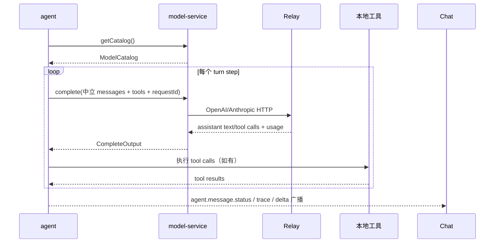
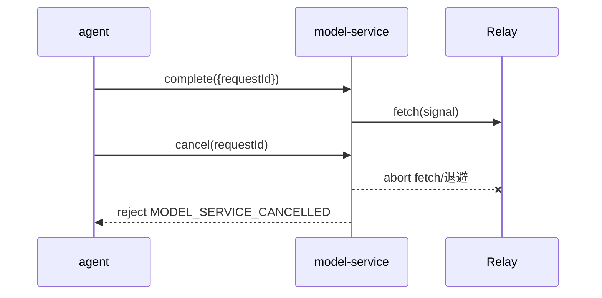

# Agent Chat Kit 的 model-service Plugin

`model-service` 是 Agent Chat Kit 内负责模型访问的后台 Plugin。它把模型配置、凭据解析、协议适配和
HTTP transport 从 `agent` 的会话与工具循环中隔离出来，同时保留当前 Harbors Relay 的兼容入口。

本文描述当前 V1 的边界；它不是 `ctx.config`/`ctx.credentials` Profile 配置方案。

## 职责边界

### model-service 负责

- 读取 legacy 环境变量和 DSH Relay 配置；优先级保持为显式 `HARBORS_RELAY_*`、`PI_AGENT_*`、DSH 配置。
- 解析模型目录、默认模型、上下文窗口以及模型的 reasoning effort/service tier 元数据。
- 读取 DSH 兼容凭据。凭据只在 Plugin 内存中用于请求，不进入消息返回值、日志、会话事件或模型目录；DSH credential 路径不是普通文件、权限包含 `0o077` 或读取异常时，以脱敏的 `MODEL_SERVICE_NOT_CONFIGURED` 失败，只有 `ENOENT` 视为缺失。
- 根据配置选择 `openai-completions` 或 `anthropic-messages`，构造 URL、认证 Header 和 provider payload。
- 执行单次 HTTP 请求、超时、重试、`Retry-After` 退避、响应归一化和取消。

### agent 负责

- 会话生命周期、事件日志、上下文 surface、压缩决策、工具定义、工具执行、权限、trace 和 UI 状态广播。
- 将事件 surface 转换为中立的模型消息，并把模型返回的 tool calls 解析后执行。
- 在下一轮 request 中带回 assistant tool calls 和 tool results；`model-service` 不执行本地工具。

两者之间只通过消息 request 交互。Plugin 不直接 import 另一 Plugin 的实现，也不使用
`plugin.callPlugin` 作为业务通道。

## 消息契约

`model-service/package.json` 声明以下 request：

```text
model-service.getCatalog()
model-service.complete(input)
model-service.cancel(requestId)
```

V1 没有模型配置写入，因此不发送 `model-service.catalog.changed` 广播。Agent 继续向 Chat/Conversation
Plugin 广播既有的会话、trace、delta 和 status 主题；这些是 Agent 的 UI 可见状态，不是 model-service
内部协议。

### getCatalog

输入为空，返回：

```ts
interface ModelCatalogEntry {
  id: string;
  name: string;
  description?: string;
  contextWindow?: number;
  reasoningEfforts?: string[];
  serviceTiers?: string[];
  defaultReasoningEffort?: string;
  defaultServiceTier?: string;
}

interface ModelCatalog {
  models: ModelCatalogEntry[];
  defaultModel: string;
  configurationError?: {
    code: 'MISSING_BASE_URL' | 'MISSING_CREDENTIAL';
    message: string;
  };
}
```

配置缺失仍返回 catalog，便于 Agent 显示稳定的配置提示；`message` 不包含凭据、凭据文件路径或实际
环境变量名。没有 DSH 模型目录时保留当前 fallback 模型行为。

### complete

输入和输出使用 provider-neutral 结构：

```ts
interface TextContentBlock { type: 'text'; text: string; }
interface ImageContentBlock { type: 'image'; mediaType: string; data: string; }
type ContentBlock = TextContentBlock | ImageContentBlock | Record<string, unknown>;

interface NeutralToolCall {
  id: string;
  name: string;
  arguments: string;
}

interface NeutralMessage {
  role: 'user' | 'assistant' | 'tool';
  content: string | ContentBlock[] | null;
  toolCalls?: NeutralToolCall[];
  toolCallId?: string;
  isError?: boolean;
}

interface CompleteInput {
  requestId: string;
  purpose: 'turn' | 'compaction';
  model?: string;
  system?: string;
  messages: NeutralMessage[];
  tools?: Array<{
    name: string;
    description: string;
    inputSchema: Record<string, unknown>;
  }>;
  maxOutputTokens?: number;
  retryMode?: 'default' | 'disabled';
}

interface CompleteOutput {
  requestId: string;
  model: string;
  message: {
    role: 'assistant';
    content: string | ContentBlock[] | null;
    toolCalls?: NeutralToolCall[];
  };
  usage?: {
    inputTokens: number;
    outputTokens: number;
    totalTokens: number;
    cacheReadTokens?: number;
    cacheWriteTokens?: number;
    reasoningTokens?: number;
  };
}
```

`purpose: "turn"` 使用正常重试，普通主模型请求的输出上限为 16,384；`purpose: "compaction"` 使用
`retryMode: "disabled"`，由 Agent 决定何时压缩上下文，压缩请求的上限沿用调用方传入值。

`arguments` 保留 tool call 的 JSON 文本，Agent 负责解析和执行；model-service 只负责 provider 间的
tool schema/消息转换。`usage` 只有输入/输出用量统计，不是访问凭据。

### cancel

消息运行时的 request 参数是可序列化值，不能传递 `AbortSignal`。因此每次 `complete` 使用 Agent 生成的
不透明 `requestId`，Agent 的 turn signal 取消时另发 `cancel(requestId)`：

```ts
interface CancelOutput {
  requestId: string;
  state: 'cancelled' | 'completed' | 'not_found';
}
```

`cancel` 会中止 HTTP fetch 或 retry 退避；对应的 `complete` request reject 为
`MODEL_SERVICE_CANCELLED`，取消后不得再重试。Plugin unload 会中止所有活动请求并 reject 为
`MODEL_SERVICE_STOPPED`。

## 消息顺序

### 正常 turn



### 取消



### 配置广播

V1 没有配置写入，所以没有 `model-service -> broadcast` 链路。后续 Profile 管理阶段可以新增
`model-service.catalog.changed`，顺序应为“配置写入成功 → model-service 广播 → Agent/UI 重新
`getCatalog`”；广播不能携带凭据或 legacy 配置引用。

## HTTP 与错误语义

OpenAI-compatible 请求继续使用 `${baseUrl}/chat/completions`、Bearer Header、`stream: false`；
Anthropic 请求继续使用 `${baseUrl}/v1/messages`、`x-api-key`、`anthropic-version: 2023-06-01`。
请求体由中立消息转换而来，Provider 细节不暴露给 Agent。

默认可重试状态为 408、429、500、502、503、504；网络错误按现有兼容逻辑处理，默认最多 2 次重试，
基础退避 1 秒、上限 8 秒，并尊重有界 `Retry-After`。只有 HTTP 413，或 HTTP 400 且正文命中上下文/token
上限模式时，才返回 `MODEL_SERVICE_CONTEXT_OVERFLOW`；5xx 即使正文包含 `context` 字样，也不得误判为
context overflow：

```ts
type ModelServiceErrorCode =
  | 'MODEL_SERVICE_NOT_CONFIGURED'
  | 'MODEL_SERVICE_UNSUPPORTED_API'
  | 'MODEL_SERVICE_HTTP_ERROR'
  | 'MODEL_SERVICE_CONTEXT_OVERFLOW'
  | 'MODEL_SERVICE_INVALID_RESPONSE'
  | 'MODEL_SERVICE_NETWORK_ERROR'
  | 'MODEL_SERVICE_TIMEOUT'
  | 'MODEL_SERVICE_CANCELLED'
  | 'MODEL_SERVICE_STOPPED';
```

错误通过 request reject 传递，跨 Plugin/进程边界依赖稳定 `code` 和安全 `message`，不依赖未纳入运行时
错误协议的自定义 `status` 或原始 response body。

## 安全边界

- `CompleteInput` 不能包含 `apiKey`、Header、base URL、credential file path 或 `apiKeyEnv`。
- `ModelCatalog`、`CompleteOutput` 和错误 message 不返回真实凭据、凭据来源、凭据文件路径或环境变量名。
- DSH credential 路径非普通文件、权限包含 `0o077` 或读取异常时，以脱敏的 `MODEL_SERVICE_NOT_CONFIGURED` 失败；只有 `ENOENT` 才视为凭据缺失。
- Provider Header 只在 model-service 内部构造；原始 provider response 不跨消息边界返回。
- 测试可以使用临时文件和假值，但不能读取或打印当前用户真实 DSH 凭据。
- usage 统计是数量，不是访问 Token；Agent 可将其写入既有 trace 以维持上下文统计。

## 实现与迁移位置

当前 Plugin 位于 `kits/agent-chat/plugins/model-service`：

```text
model-service/
├── package.json
└── main/src/
    ├── index.ts       # lifecycle、request handler、活动请求与取消
    ├── types.ts       # 消息/目录/错误类型
    ├── config.ts      # legacy env、DSH 配置与凭据兼容读取
    ├── protocol.ts    # OpenAI/Anthropic 转换与响应归一化
    └── index.test.ts   # Plugin 聚焦测试
```

Agent 通过 `runtime.message.request('model-service', ...)` 注入客户端；Agent 保留会话、工具循环和
compaction，模型请求不再由 Agent 直接读取 Relay 凭据或发起 HTTP。

## 后续迁移点

1. 将 legacy env/DSH 读取替换为 `ctx.config` 的模型服务 Profile，但保留兼容层直到迁移窗口结束。
2. 将真实凭据接入 `ctx.credentials`，并继续保证凭据只在 model-service 内部可见。
3. 增加 Profile 写入、校验和 `model-service.catalog.changed` 广播；广播只通知目录变化，不携带敏感字段。
4. 若需要流式输出，可在不改变 `complete` 非流式契约的前提下另行设计带 requestId 的增量 broadcast。
