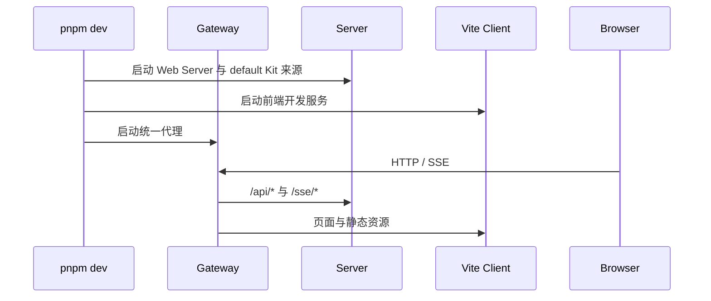

# 核心运行流程

## Web 开发栈启动

`pnpm dev` 启动 Gateway、Server 与 Client 三个开发进程；Gateway 和 Server 监听源码变化，Client 使用 Vite HMR。`pnpm start` 使用 `packages/server/src/start.ts` 直接启动单个稳定 Web Server，提供预先构建的 Client 资产，不启用开发代理、源码监听或 HMR；`HARBORS_SERVER_PORT` 和 `HARBORS_BIND_HOST` 可覆盖默认监听。两个入口默认数据根都为 `~/.harbors/`，并以相同的 `--data-root <absolute-path>` / `HARBORS_DATA_ROOT` 契约整体切换数据库、配置和 Plugin roots。

Server 直接打开当前 data root 中的数据库与 Plugin 路径，不扫描或导入项目内旧数据源。`DB_PATH` 只覆盖 Server DB，不隐式移动 Plugin 或 Kit config 根。

## 会话创建与 bootstrap

浏览器先通过 Workbench API 为明确选择的 User 创建持久 Session，再请求初始化该已存在 Session 的 runtime。`SessionRuntimeRegistry` 只建立 Editor，不隐式写入 Session；随后装配 default Kit，加载插件并生成布局、菜单和国际化快照。URL 或缓存中的 Session 不存在或无权访问时，Client 清理相关参数并返回选择器。Client 获取 bootstrap 后渲染工作台，并用 SSE 接收后续变化。

## Panel 消息

Panel 只能通过注入的 runtime API 发送 request 或 broadcast。Server 校验 session、插件所有权和消息路由；request 必须有唯一处理器，broadcast 允许多个订阅者。

## Kit 与插件失败清理

插件装载中途失败时，Editor 按 owner 清除 Panel、Message、Menu 等贡献。Kit 切换失败时清理新集合并尽力恢复旧集合，避免留下半装载状态。

## Kit 本地校验与打包

Kit 源码由本地 `kits/` 目录发现。开发者先以 `pnpm run kit -- validate` 校验 descriptor 与声明文件，再以 `pnpm run kit -- pack` 生成 `.hkit`，并用 `pnpm run kit -- inspect` 检查制品内容。合并源码不会触发额外的制品分发流程。
