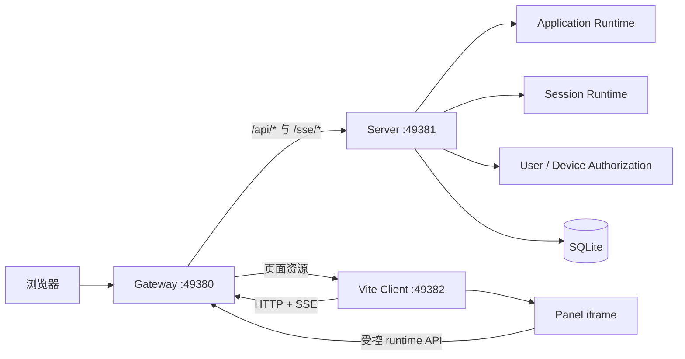
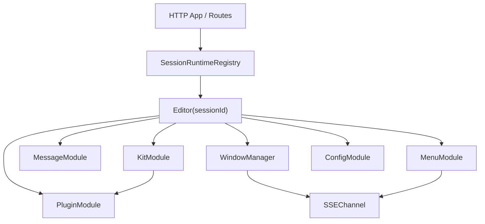

# 系统架构

ITHARBORS 采用单一 Web host。Server 持有运行时权威状态，Client 在浏览器中渲染工作台，Gateway 只在开发环境提供统一代理入口。仓库不包含 Electron 或桌面发行链。

## 运行拓扑

`pnpm dev` 启动 Gateway、Server 与 Client 三个开发进程：Gateway 和 Server 监听源码变化，Client 由 Vite 提供 HMR。`pnpm start` 则在先完成构建后启动单个 Web Server，直接提供构建后的 Client 资产，默认监听 `48381`，从 `kits/default` 装配内置 Kit；它不启动开发代理、源码监听或 HMR。两个入口都把正式运行数据写入 `~/.harbors/`，不以当前 cwd、checkout 或 worktree 推导数据根。

默认布局为：Server 状态使用 `~/.harbors/harbors.db`，Kit 配置使用 `~/.harbors/config.sqlite`，Plugin owner 私有数据使用 `~/.harbors/plugins/{data,cache,temp}/<owner-sha256>/`。启动前迁移会从项目 `.data/harbors.db`、`packages/server/.editor.db` 和旧 Plugin data 根只导入目标缺失的数据；已有目标记录优先，源文件不会自动删除。

## Workspace 职责

| 路径 | 职责 |
| --- | --- |
| `packages/gateway` | 开发环境统一入口与反向代理 |
| `packages/server` | 会话、Editor、Kit/插件、消息、API、SSE 和存储 |
| `packages/client` | 浏览器工作台、Web Components、布局、主题和传输层 |
| `packages/plugin-types` | 插件和 Panel 可见协议 |
| `plugins` | 框架级内置插件 |
| `kits/default` | 内置 default Kit 的 descriptor、布局和插件组合 |
| `scripts` | 构建、检查、Task 与 Kit 制品工具 |

## Server 装配

每个 session 拥有独立 Editor。Kit、插件、布局、菜单与消息路由的权威状态在 Server；Client 只保存渲染所需快照和短暂交互状态。

Server 同时持有 User、授权设备和 Session owner 的权威关系。所有携带基础或复合 runtime ID 的 HTTP/SSE 入口在访问 Editor 前经过同一 owner 策略；本地管理入口可查看用户与未分配 Session，远程设备只获得绑定用户的公开摘要。Client 的裸入口按“用户 → Session → Kit”选择，不再自行生成或默认认领 Session。

## 依赖方向

1. 路由只依赖 Editor 公共接口。
2. Editor 装配 framework 模块并负责回滚与清理。
3. framework 不依赖具体 Kit 或产品插件。
4. Client 只依赖 HTTP/SSE 契约。
5. Panel 通过受限 runtime API 通信。

## 源码索引

- [Web 开发栈](../../scripts/dev.mjs)
- [Web Server 入口](../../packages/server/src/start.ts)
- [Gateway](../../packages/gateway/src/index.ts)
- [Server](../../packages/server/src/server.ts)
- [Editor](../../packages/server/src/editor/index.ts)
- [Client](../../packages/client/src/components/editor-app.ts)
